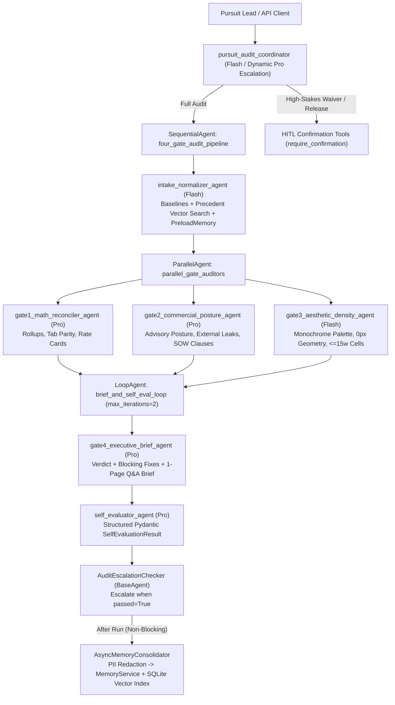

# DESIGN_SPEC.md — Pursuit Deliverable Auditor (Google ADK)

## 1. Overview & Problem Statement

Enterprise cloud consulting Pursuit Leads produce high-stakes deliverables under
tight review cycles — Services Strategy decks, executive whitepapers, customer
and system-integrator (SI) partner proposals, and Preview SOWs. Manual pre-flight
review frequently misses four costly failure classes:

1. **Financial & Rollup Drift (Gate 1):** Summary funding totals diverge from
   deep-dive workstream tables, raw workbook tabs are cited instead of approved
   post-discount tabs, or FTE-month staffing drifts from planning rate cards.
2. **Commercial Posture & Pricing Leaks (Gate 2):** Advisory Control Tower decks
   accidentally claim hands-on SI execution ownership, or external customer/partner
   decks expose internal monthly FTE rate cards and credit ratios.
3. **Executive Aesthetic & Wall-of-Text Clutter (Gate 3):** Dense 30+ word table
   cells, emojis, rounded pastel card grids, and inconsistent typography erode
   executive credibility.
4. **Live Q&A Unpreparedness (Gate 4):** Leaders enter pricing or CIO reviews
   without a 1-page Numbers Lineage map and rehearsed answers to the toughest
   stakeholder challenges.

The **Pursuit Deliverable Auditor** solves this with a strictly read-only,
multi-agent **Google ADK (Python)** architecture that runs all four audit gates,
verifies its own output in a bounded 2-pass self-evaluation loop, pauses for
explicit human confirmation on high-stakes waivers/release certifications, and
emits full OpenTelemetry + PII-redacted structured telemetry.

## 2. Architecture & Multi-Agent Pattern

## 3. Tools Required & Strict JSON Contracts

| Tool Name | Gate / Role | Auth / Store | HITL Confirmation |
| :--- | :--- | :--- | :--- |
| `fetch_authoritative_deal_baseline` | Intake / Gate 1 | Read-only baseline catalog (synthetic fixtures) | No |
| `reconcile_financial_rollups_and_rate_cards` | Gate 1 | Deterministic financial engine | No |
| `inspect_commercial_posture_and_leak_guardrails` | Gate 2 | Deterministic policy & regex engine | No |
| `audit_executive_aesthetic_and_density` | Gate 3 | Deterministic visual & density engine | No |
| `retrieve_historical_audit_precedents` | Intake / Gate 2 | Persistent SQLite vector index (+ optional Vertex AI Search) | No |
| `record_numbers_lineage_citation` | Gate 1 / Gate 4 | Persistent ADK session state | No |
| `request_human_waiver_signoff` | Governance | Session state + ADK confirmation hook | **Always (`require_confirmation=True`)** |
| `certify_deliverable_for_external_release` | Governance | Session state + ADK conditional predicate | **Conditional (`audience in {customer, partner}`, `blocking_count > 0`, or `TCV >= $5M`)** |

## 4. Constraints, Privacy & Safety Guardrails

* **Strictly Read-Only (`ReadOnlyEnforcementPlugin`):** Blocks any tool starting
  with `mutate_`, `delete_`, `write_`, `update_`, `drop_`, or containing SQL DML.
* **Prompt Injection & Leak Defense (`ModelArmorPolicyPlugin`):** Integrates
  Google Cloud Model Armor API with deterministic local defense-in-depth rules
  blocking verdict tampering, system-prompt exfiltration, and outbound rate-card
  leaks for external audiences.
* **PII Redaction (`PIIRedactor`):** Integrates Google Cloud DLP API with
  deterministic regex redaction across all structured JSON logs, async memory
  consolidation writes, and outbound responses.
* **Synthetic Data Governance:** All bundled baselines, precedents, and eval
  cases use 100% fictional accounts (`Northstar Retail`, `Crestline Logistics`,
  `Meridian Health`) and illustrative planning benchmarks.

## 5. Success Criteria & Evaluation Strategy

* **Code & Contract Verification (`pytest tests/unit tests/integration`):**
  100% pass rate on Pydantic schemas, guided error recovery, plugin policy
  enforcement, HITL pauses, OpenTelemetry spans, PII redaction, persistent
  SQLite session reload, async memory consolidation, and zero bare `print()`.
* **Golden Regression Suite (`pytest tests/eval` + `adk eval`):**
  6 golden synthetic scenarios (Clean PASS, Gate 1 Math Drift, Gate 2 External
  Pricing Leak, Gate 2 Execution Overreach, Gate 3 Wall-of-Text/Rainbow Clutter,
  and HITL High-TCV Release Pause) achieving 100% deterministic verdict accuracy
  and ADK `tool_trajectory_avg_score >= 0.90`.
