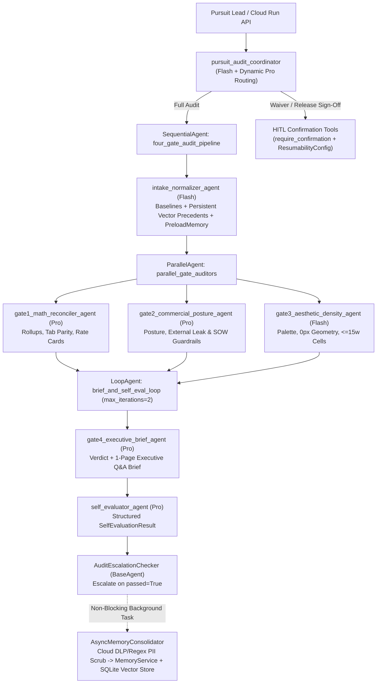

# Pursuit Deliverable Auditor (`pursuit_auditor`)

An independent, strictly read-only **multi-agent Google ADK (Python)** system that audits high-stakes Enterprise Cloud Consulting deliverables — Services Strategy decks, executive whitepapers, customer/partner proposals, and Preview SOWs — across **4 deterministic & reasoning gates** before executive or external review.

> **Data Governance Notice:** All bundled baselines (`Northstar Retail`, `Crestline Logistics`, `Meridian Health`), rate-card planning benchmarks, historical precedents, and golden evaluation cases are **100% synthetic**. This repository contains zero real customer data, CRM records, or credentials.

---

## Problem & Solution

Enterprise Pursuit Leads iterate rapidly on complex financial constructs, SI partner splits, and executive decks. Manual pre-flight checks routinely miss subtle math drift across slides, legacy workbook tab references, advisory-vs-execution liability language, external rate-card leaks, or cluttered table formatting.

**Pursuit Deliverable Auditor** solves this with a production **AgentOps multi-agent architecture** built on **Google ADK**:

1. **Gate 1 — Math, Scope & Cross-Slide Reconciliation (`gemini-2.5-pro`):** Reconciles row sums (`GSF (PSO) + PSF (Partner) = Total cost to migrate/implement`), executive summary rollups, authoritative post-discount tab parity, timeline chevrons, and FTE-month rate-card math.
2. **Gate 2 — Commercial Posture & Confidentiality Guardrails (`gemini-2.5-pro`):** Enforces Control Tower advisory boundaries, blocks internal rate-card / credit-ratio leaks for `customer` or `partner` audiences, validates Services Strategy table conventions, and checks SOW mandatory clauses.
3. **Gate 3 — Executive Aesthetic, Visual Density & Tone (`gemini-2.5-flash`):** Audits monochrome graphite + single `#1A73E8` focal accent discipline, sharp `0px` geometry, locked `10–24 pt` typography, all-or-nothing kickers, zero emojis, and the 15-word table cell ceiling.
4. **Gate 4 — Bounded Self-Evaluation & Mandatory 1-Page Executive Q&A Brief (`gemini-2.5-pro`):** Synthesizes the `PASS` / `REVISE` verdict, copy-ready Blocking Fixes table, Numbers Lineage table, 3–5 load-bearing assumptions, and 5 audience-tailored stakeholder Q&As — verified inside a bounded 2-pass `LoopAgent` self-evaluator.

---

## Multi-Agent Architecture



---

## AgentOps Code Review Matrix (19 / 19 Capabilities)

| Category | Capability | Implementation Evidence |
| :--- | :--- | :--- |
| **1. Tool & Interface Design** | Comprehensive Tool Docstrings | Google-style docstrings (`Args:`, `Returns:`) on every tool in [`pursuit_auditor/tools/`](pursuit_auditor/tools/), statically verified by [`tests/unit/test_code_hygiene.py`](tests/unit/test_code_hygiene.py) |
| | Descriptive Naming | Domain-specific names (`reconcile_financial_rollups_and_rate_cards`, `inspect_commercial_posture_and_leak_guardrails`, `audit_executive_aesthetic_and_density`, `certify_deliverable_for_external_release`) |
| | Explicit JSON Schemas | Strict Pydantic v2 `BaseModel` (`extra="forbid"`) schemas + JSON Schema exporter in [`pursuit_auditor/schemas.py`](pursuit_auditor/schemas.py) and ADK `output_schema=SelfEvaluationResult` |
| | Guided Error Handling | Structured `ToolErrorResponse` with `error_code`, `missing_fields`, `recovery_instructions`, and `retry_example` across every tool plus [`IntentOutcomeAuditPlugin.on_tool_error_callback`](pursuit_auditor/plugins/intent_outcome.py) |
| **2. Context & Memory** | Robust System Instructions | Explicit persona, read-only contract, synthetic benchmarks, and 4-gate constitution in [`pursuit_auditor/prompts.py`](pursuit_auditor/prompts.py) + ADK `GlobalInstructionPlugin` |
| | History Compaction | ADK `EventsCompactionConfig` (`LlmEventSummarizer`), `ContextCacheConfig`, `ContextFilterPlugin`, and `TokenBudgetSlidingWindowCompactor` in [`pursuit_auditor/memory/compaction.py`](pursuit_auditor/memory/compaction.py) |
| | Persistent Session State | ADK `DatabaseSessionService` (SQLite locally, Cloud SQL PostgreSQL in prod) / `VertexAiSessionService` in [`pursuit_auditor/memory/session_store.py`](pursuit_auditor/memory/session_store.py) + persistent SQLite vector precedent index & optional `VertexAiSearchTool` in [`pursuit_auditor/memory/vector_store.py`](pursuit_auditor/memory/vector_store.py) |
| | Async Memory Operations | Non-blocking `asyncio.Queue` background worker (`AsyncMemoryConsolidator`) + `AsyncMemoryPersistencePlugin` (`after_run_callback`) in [`pursuit_auditor/memory/async_memory.py`](pursuit_auditor/memory/async_memory.py) |
| **3. Orchestration & Logic** | Multi-Agent Patterns | Root Coordinator + `SequentialAgent` + `ParallelAgent` (Gates 1–3) + bounded `LoopAgent` (`max_iterations=2`) + custom `AuditEscalationChecker(BaseAgent)` in [`pursuit_auditor/sub_agents/audit_gates.py`](pursuit_auditor/sub_agents/audit_gates.py) |
| | Strategic Model Routing | Tiered `ModelRouter` (`gemini-2.5-flash` vs. `gemini-2.5-pro`) + runtime `DynamicModelRoutingPlugin` (`before_model_callback`) in [`pursuit_auditor/routing.py`](pursuit_auditor/routing.py) |
| | Guardrails & Policy Plugins | `ReadOnlyEnforcementPlugin`, `ModelArmorPolicyPlugin` (Google Cloud Model Armor + local rules), `SelfEvaluationGuardrailPlugin`, and `ReflectAndRetryToolPlugin` in [`pursuit_auditor/plugins/guardrails.py`](pursuit_auditor/plugins/guardrails.py) |
| | Human-in-the-Loop Hooks | ADK `ResumabilityConfig(is_resumable=True)` + `FunctionTool(..., require_confirmation=...)` & `tool_context.request_confirmation(...)` in [`pursuit_auditor/tools/hitl_tools.py`](pursuit_auditor/tools/hitl_tools.py) |
| **4. Observability & Tracing** | Structured JSON Logging | Cloud Logging-compatible `structlog` JSON pipeline (zero bare `print()`) in [`pursuit_auditor/observability/logging.py`](pursuit_auditor/observability/logging.py) |
| | Intent vs. Outcome Capture | Paired `audit_phase="INTENT"` (before) & `audit_phase="OUTCOME"` (after) JSON logs correlated by `correlation_id` in [`pursuit_auditor/plugins/intent_outcome.py`](pursuit_auditor/plugins/intent_outcome.py) |
| | Distributed Tracing | OpenTelemetry `TracerProvider`, linked parent-child spans, W3C trace-log correlation, `CloudTraceSpanExporter`, and `otel_to_cloud=True` in [`pursuit_auditor/observability/tracing.py`](pursuit_auditor/observability/tracing.py) & [`pursuit_auditor/fast_api_app.py`](pursuit_auditor/fast_api_app.py) |
| | PII Redaction | Google Cloud DLP (`google-cloud-dlp`) + deterministic regex defense-in-depth scrubbing pre-log, pre-memory, and pre-response in [`pursuit_auditor/observability/pii_redactor.py`](pursuit_auditor/observability/pii_redactor.py) |
| **5. Infrastructure & CI/CD** | Automated Evaluation Suites | Unit, integration, AST hygiene, and 6-case golden regression suite (`tests/unit/`, `tests/integration/`, `tests/eval/evalsets/pursuit_auditor_golden.evalset.json`, `tests/eval/eval_config.json`) + [`.github/workflows/ci-eval-deploy.yml`](.github/workflows/ci-eval-deploy.yml) |
| | Infrastructure as Code | Modular Terraform (`deployment/terraform/`) provisioning Cloud Run v2, Cloud SQL PostgreSQL 16, Artifact Registry, Secret Manager, least-privilege IAM + GitHub WIF, GCS/BigQuery telemetry, plus `Dockerfile`, `Makefile`, and `agents-cli` / `adk` workflows |
| | Secure Secret Management | Google Cloud Secret Manager provider with TTL caching and zero hardcoded keys in [`pursuit_auditor/config/secrets.py`](pursuit_auditor/config/secrets.py) + Cloud Run `secret_key_ref` in [`deployment/terraform/cloud_run.tf`](deployment/terraform/cloud_run.tf) |

---

## Quickstart (Local Development)

### Prerequisites
- Python 3.11+ and [`uv`](https://docs.astral.sh/uv/)
- Optional for Google Cloud deployment: `gcloud`, Terraform >= 1.7, and [`google-agents-cli`](https://github.com/GoogleCloudPlatform/agent-starter-pack) (`uv tool install google-agents-cli`)

### 1. Install Dependencies & Configure Local Environment
```bash
git clone https://github.com/sayasene/ai_in_five_days_MS.git
cd ai_in_five_days_MS

uv sync --extra dev
cp .env.example .env
# Edit .env locally to set GOOGLE_API_KEY (or configure Vertex AI ADC); never commit .env
```

### 2. Run Lint, Static Typing, Unit/Integration Tests & Golden Eval Suite
```bash
make lint        # ruff check pursuit_auditor tests
make typecheck   # mypy pursuit_auditor
make test        # pytest tests/unit tests/integration
make eval        # pytest tests/eval (6 deterministic golden regression scenarios)
```

### 3. Run Interactively with ADK CLI or Google `agents-cli`
```bash
# Option A: Official ADK Developer Web UI
uv run adk web .

# Option B: Official ADK CLI single-turn / interactive run
uv run adk run pursuit_auditor

# Option C: Google Agents CLI workflow (if installed via `uv tool install google-agents-cli`)
agents-cli info
agents-cli playground
agents-cli run "Audit deal OPP-SYNTH-2026-001 (Northstar Retail) for internal leadership."
```

### 4. Run Live LLM-as-Judge Evaluation (ADK Evaluator)
```bash
make eval-adk
# Equivalent to:
# uv run adk eval pursuit_auditor tests/eval/evalsets/pursuit_auditor_golden.evalset.json \
#   --config_file_path tests/eval/eval_config.json --print_detailed_results
# Or via agents-cli:
# agents-cli eval run tests/eval/evalsets/pursuit_auditor_golden.evalset.json
```

---

## Infrastructure as Code & Production Deployment (GCP)

All GCP resources are defined declaratively in [`deployment/terraform/`](deployment/terraform/):
- **Cloud Run v2 (`cloud_run.tf`)**: Hosts `pursuit_auditor.fast_api_app:fastapi_app` with `otel_to_cloud=True`, `/healthz` probes, Cloud SQL Unix socket mount, and Secret Manager env injection (`value_source.secret_key_ref`).
- **Cloud SQL PostgreSQL 16 (`database.tf`)**: Persistent ADK `DatabaseSessionService` store + `pgvector`-ready precedent database using IAM database authentication.
- **Secret Manager (`secrets.tf`)**: Manages `pursuit-auditor-gemini-api-key` and `pursuit-auditor-session-db-url` with least-privilege `roles/secretmanager.secretAccessor` granted exclusively to `app_sa`.
- **Observability (`observability.tf`)**: Uniform-access GCS telemetry bucket, BigQuery Agent Analytics dataset, and Cloud Monitoring 5xx spike alert policy.
- **Keyless CI/CD (`iam.tf` + `.github/workflows/ci-eval-deploy.yml`)**: Workload Identity Federation (WIF) lets GitHub Actions build, validate, and deploy without storing any JSON service account keys.

### Provision & Deploy Commands
```bash
# 1. Validate Terraform locally
make tf-validate

# 2. Provision single-project dev infrastructure (Terraform or agents-cli)
cd deployment/terraform
terraform plan -var-file=environments/dev.tfvars
terraform apply -var-file=environments/dev.tfvars

# 3. Populate Secret Manager versions out-of-band (never store in git)
printf '%s' "$SESSION_DB_URL" | gcloud secrets versions add pursuit-auditor-session-db-url --data-file=-

# 4. Deploy with Google Agents CLI (preview first with --dry-run)
agents-cli deploy --deployment-target cloud_run --region us-central1 --dry-run
agents-cli deploy --deployment-target cloud_run --region us-central1
```

---

## Repository Layout

```text
.
├── .env.example
├── .github/workflows/ci-eval-deploy.yml
├── DESIGN_SPEC.md
├── Dockerfile
├── Makefile
├── README.md
├── pyproject.toml
├── deployment/terraform/
│   ├── apis.tf
│   ├── cloud_run.tf
│   ├── database.tf
│   ├── iam.tf
│   ├── observability.tf
│   ├── outputs.tf
│   ├── secrets.tf
│   ├── variables.tf
│   ├── versions.tf
│   └── environments/{dev,prod}.tfvars
├── pursuit_auditor/
│   ├── __init__.py
│   ├── agent.py
│   ├── fast_api_app.py
│   ├── prompts.py
│   ├── routing.py
│   ├── schemas.py
│   ├── config/{secrets,settings}.py
│   ├── data/synthetic_{baselines,precedents}.json
│   ├── memory/{async_memory,compaction,session_store,vector_store}.py
│   ├── observability/{logging,pii_redactor,tracing}.py
│   ├── plugins/{guardrails,intent_outcome}.py
│   ├── sub_agents/audit_gates.py
│   └── tools/{aesthetic,commercial,financial,hitl,memory}_tools.py
└── tests/
    ├── conftest.py
    ├── unit/
    ├── integration/
    └── eval/
        ├── eval_config.json
        ├── evalsets/pursuit_auditor_golden.evalset.json
        └── test_golden_eval_suite.py
```
